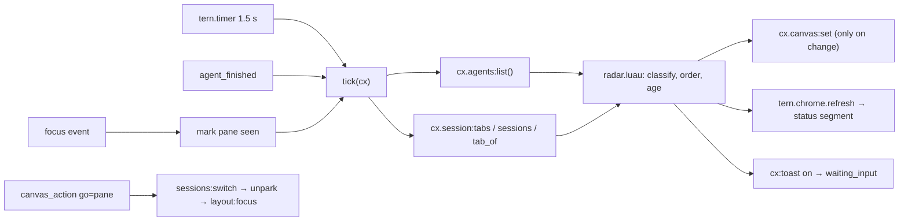

# Agent Radar — design

One pane that shows every coding agent running in Tern, across sessions and
hosts, ordered by who needs you. Click an agent to jump straight to its pane.

Mockups: [`design/agent-radar.pen`](design/agent-radar.pen) (open in Pen),
PNG previews in [`design/screens/`](design/screens).

| Screen | What it shows |
| --- | --- |
| `01-radar-beside.png` | The radar canvas beside an agent pane, status line segment |
| `02-variants.png` | Grouped by session, narrow pane (< 48 cols), empty state |
| `03-quick-jump.png` | Keyboard picker (`cx:pick`) and the "needs you" toast |
| `04-notes.png` | Behavior notes |

## Shape

Window-only plugin (`window = "window.luau"`, no host half). The radar is a
native `tern.canvas` pane owned by the plugin.

Why window-only: agent state (`working` / `waiting_input` / `idle` /
`exited`) exists only in the window, through `cx.agents:list()`. A host block
would need the window to feed it through `tern.kv` and a link route to jump
back, for one gain: keys inside the pane. The canvas takes no keys, so the
keyboard path is the picker command instead.



## Data per row

| Field | Source |
| --- | --- |
| state | `AgentBlock.state`; `done` / `failed` from `agent_finished.result`, kept until the agent works again or you focus it |
| name | basename of `AgentBlock.cwd` (fallback: pane title) |
| branch | `cx.git:repo(cwd)` (async, local hosts only), cached per cwd, refreshed every 30 s; hidden when unknown |
| location | session name › tab position: `cx.session:tab_of(pane)` → `cx.session:tabs()` (`session`, `position`) → `cx.session:sessions()` (`name`) |
| age | plugin-tracked: time since this window first saw the current state |
| message | first line of `AgentBlock.last_message`, cut to fit; `delivery_error` replaces it in error tone |

## Order and states

| Section | States | Order | Tone |
| --- | --- | --- | --- |
| Need you | `waiting_input` | oldest wait first | `warning`, row tinted with a left bar |
| Working | `working` | longest first | `info` |
| Done · unseen | turn ended `done` / `failed`, pane not focused since | newest first | `success` / `error` |
| Idle (collapsed) | `idle` seen, `exited` | most recent first | `muted` |

The pane currently focused gets a subtle highlight. Stats chips at the top
filter to one section; clicking the active chip clears the filter. The dock
toggles grouping between **Status** (default) and **Session** (sections per
session, rows sorted by the status order above).

Narrow pane (< 48 columns, read from the canvas width when available):
single-line rows (dot, name, `session›tab`, age), no branch or message.

## Interactions

| Action | Behavior |
| --- | --- |
| Palette **Agent Radar** (`plugin.agent-radar.open`) | Opens the canvas beside the focused pane with `focus = false`; if one already exists (`cx.canvas:list()`, owner `agent-radar`), focuses it |
| Palette **Jump to agent** (`plugin.agent-radar.jump`) | `cx:pick` with groups Need you / Working / Done / Idle; ↵ jumps |
| Click a row | `go=<pane>`: switch to the agent's session, unpark it if parked, focus it, mark it seen |
| Click a stat chip | `filter=<section>` |
| Dock toggle | `group=status` / `group=session`, kept in `tern.kv` |
| Status line segment | Counts for need-you / working / done; click runs `plugin.agent-radar.open` |
| Toast | On the transition into `waiting_input`, once per wait, skipped when that pane is focused |

## Implementation notes

- **Canvas nodes.** Rows carry `key = "agent:<pane>"` so updates go through
  `cx.canvas:set{ set = {...} }` per row, not whole-view replaces. Rows use
  `actions = { click = "go=<pane>" }`; the idle group is a collapsible
  `section` (built-in `toggle`, no handler). Limits: 2000 nodes, 256 KiB per
  change, no key or input nodes.
- **Styling.** Colors come from tones (`warning`, `info`, `success`, `error`,
  `muted`), not hex values, so themes keep working. Extra spacing/tint via
  `tern.css`, scoped by a `role = "agent-radar"` on the root node (canvases
  share the `plugin.tern.canvas` surface).
- **Budgets.** Window calls get 50 ms, chrome formatters 4 ms. The status
  formatter only reads counts the tick already computed.
- **Pure core.** `radar.luau` turns `{agents, tabs, sessions, seen, since,
  finished, now}` into an ordered model without touching `tern`, so it is
  tested with the plain `luau` CLI (same split as `tern-gpg-touch/match.luau`).

Planned files:

```
plugin.toml        window entry only
window.luau        commands, timer, events, canvas wiring
radar.luau         pure model: classify, order, ages, text cuts
view.luau          model → tern.ui nodes (wide, narrow, empty)
tests/radar.test.luau
```

## To verify while implementing

These are API behaviors the docs don't settle; each one is checked in a
running Tern before the code depends on it.

1. `cx.layout:focus(pane)` on a pane in another session: does it switch
   sessions by itself, or is `cx.sessions:switch` needed first?
2. Session of a parked agent: parked panes have no tab, so `tab_of` is nil.
   Fallback is "parked" without a session name unless another API exposes it.
3. Agents on remote hosts: `cx.agents:list()` says "across every session";
   confirm remote ones appear and whether `cx.git:repo` must be skipped for them.
4. Two windows open: both VMs update the same canvas. Acceptable if the
   snapshot is identical; "seen" and ages are per window, so the last writer
   wins. Decide whether only the window holding the canvas updates it.
5. Default chords (`cmd+shift+r` open, `cmd+shift+a` jump): check
   `cx.actions:keys()` for conflicts.
6. Canvas width for the narrow layout: `CanvasInfo` has no size; may need
   `cx.session:pane(pane)` or a fixed breakpoint chosen by the user in kv.
