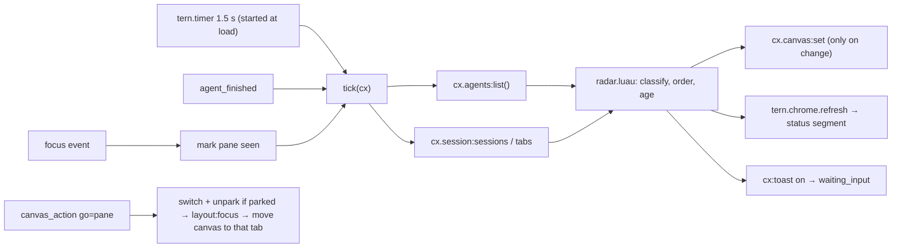

# Agent Radar — design

One pane that shows every coding agent running in Tern, across sessions,
ordered by who needs you. Click an agent to jump straight to its pane.

Mockups: [`design/agent-radar.pen`](design/agent-radar.pen) (open in Pen),
PNG previews in [`design/screens/`](design/screens). They predate the
implementation; where they differ (key chords, narrow layout), this file and
the code win.

| Screen | What it shows |
| --- | --- |
| `01-radar-beside.png` | The radar canvas beside an agent pane, status line segment |
| `02-variants.png` | Grouped by session, narrow pane, empty state |
| `03-quick-jump.png` | Keyboard picker (`cx:pick`) and the "needs you" toast |
| `04-notes.png` | Behavior notes |

## Shape

Window-only plugin (`window = "window.luau"`, no host half). The radar is a
native `tern.canvas` pane owned by the plugin.

Why window-only: agent state (`working` / `waiting_input` / `idle` /
`exited`) exists only in the window, through `cx.agents:list()`. A host block
would need the window to feed it through `tern.kv` and a link route to jump
back, for one gain: keys inside the pane. The canvas takes no keys, so the
keyboard path is the picker command instead.



## Data per row

| Field | Source |
| --- | --- |
| state | `state` from `cx.agents:list()`; `done` / `failed` when a turn ends (working/waiting → idle, `failed` from `agent_finished`), kept until the agent works again or you focus it |
| name | basename of `cwd` (fallback: pane title) |
| branch | `cx.git:repo(cwd)` (async), local-host agents only, cached per cwd, refreshed every 30 s; hidden when unknown |
| location | `session` and `tab` fields of `cx.agents:list()` (present at runtime, not in `tern.d.luau`): session name from `cx.session:sessions()`, tab position from `cx.session:tabs()`; `parked` when the agent is in the deck |
| age | time since the radar first saw the current state, kept in `tern.kv` so reloads and other windows agree |
| message | first line of `last_message`, cut to 160 characters; `delivery_error` replaces it in error tone |

## Order and states

| Section | States | Order | Row tone and mark |
| --- | --- | --- | --- |
| Needs you | `waiting_input` | oldest wait first | `warning`; a card (tinted border and fill) with the question as the main line, location beside the age |
| Working | `working` | longest first | `info`; a ring |
| Done | turn ended `done` / `failed`, pane not focused since | newest first | `success` ✓ / `error` ✕ |
| Idle (collapsed) | `idle` seen, `exited` | most recent first | `muted`; a hollow dot |

Only the section that needs you takes a color in its heading (`warning`);
the others are `muted`, and nothing draws rules or separators: spacing
carries the structure. Rows read name, branch and age on the first line; message and
location on the second. The pane currently focused gets a subtle highlight.
Stat chips at the top (pills; "need you" is tinted while any agent waits)
filter to one section; clicking the active chip clears the filter. The dock
toggles grouping between **Status** (default) and **Session** (sections
named after the session, rows sorted by the status order above).

Narrow panes keep the same layout: the chips wrap, the branch and the
message cut with an ellipsis first, the name last. Tern's CSS has no
container queries and `CanvasInfo` has no size, so there is no separate
narrow mode.

## Interactions

| Action | Behavior |
| --- | --- |
| Palette **Agent Radar** (`plugin.agent-radar.open`, `⌥⌘R`) | Opens the canvas beside the focused pane with `focus = false`. When one exists (`cx.canvas:list()`, owner `agent-radar`) in another tab, it moves into this one (`cx.layout:move_to_tab`); when it is in this tab, it takes the focus |
| Palette **Jump to agent** (`plugin.agent-radar.jump`, `⌥⌘J`) | `cx:pick` with groups Needs you / Working / Done / Idle; ↵ jumps without moving the canvas. Items come from `radar.picks`: the detail always says `session › tab` (whatever the canvas grouping) and leads with the question for a waiting agent; agents with the same name get the branch, then the location, then the pane in the label, since typing filters on the label only. Icons are from Tern's own set (`message`, `run`, `check`, `x`, `pause`, `power`) |
| Click a row | `go=<pane>`: switch to the agent's session and unpark it if parked, focus it, mark it seen, move the canvas into the agent's tab (refused across hosts: then it stays) |
| Click a stat chip | `filter=<section>`; the active chip clears it |
| Dock toggle | `group=status` / `group=session`, kept in `tern.kv` |
| Status line segment | Counts for need-you / working / done; click runs `plugin.agent-radar.open` |
| Toast | On the transition into `waiting_input`, once per wait, skipped when that pane is focused; palette **Agent Radar: turn waiting toasts on or off** |

## Implementation notes

- **Canvas nodes.** The view is `tern.ui.el` divs with `ar-*` classes and a
  `tone` per row; the whole view is replaced with `cx.canvas:set` when its
  JSON changes (ages move in whole minutes, so that is at most once a minute
  when nothing else changes). The idle group is a collapsible `section`;
  Tern keeps the user's toggle across replaces because the `collapsed` prop
  stays the same. Limits: 2000 nodes, 256 KiB per change, no key or input nodes.
- **Styling.** `radar.css` (manifest `styles`), scoped by `role` on the root
  (`agent-radar`) and dock (`agent-radar-dock`), since canvases share the
  `plugin.tern.canvas` surface. Colors come from the node tone (`--tc`) and
  the surface variables (`--sf-c-*`, `--sf-neutral`), so light and dark
  themes both work.
- **Budgets.** Window calls get 50 ms, chrome formatters 4 ms. A tick took
  2–8 ms with five agents in a dev window, with one 43 ms outlier while the
  window was asleep in the background; a trip would stop the timer until the
  next reload. The status formatter only reads counts the tick computed.
- **Pure core.** `radar.luau` turns `{agents, memory, sessions, positions,
  branches, focused, now, group, filter}` into an ordered model without
  touching `tern`, so it is tested with the plain `luau` CLI.

Files:

```
plugin.toml        window entry and styles only
window.luau        commands, timer, events, canvas wiring
radar.luau         pure model: transitions, classify, order, ages, text cuts
view.luau          model → tern.ui nodes (list, folded idle, empty state)
radar.css          canvas styles
tests/radar.test.luau
```

## API behaviors it relies on

Checked in a running Tern 0.9.5 (isolated dev window with fake agents that
report OSC 9;4 progress), where the docs don't settle them:

1. `cx.layout:focus(pane)` on a pane in another session switches to that
   session by itself. A parked pane needs `cx.sessions:switch(session)` then
   `cx.layout:unpark(pane)` first, or it is dealt into the current tab.
2. `cx.agents:list()` rows also carry `session`, `tab`, `parked`, `alive`,
   `host`, `title` and `progress`. A parked agent has `session` and no `tab`.
3. Agents on another host (a loopback remote) appear in the list with their
   `host`; jumping works, moving the canvas there is refused.
4. `agent_finished` reports `failed` for an error progress state; a turn
   that just clears its progress fires no `done`, so the working → idle
   transition is what marks a turn done.
5. `window_start` does not run again on a plugin reload, so the tick loop
   starts with a timer when the entry loads.
6. A click on an unfocused canvas focuses it and delivers the action.
7. Default chords: `cmd+shift+r` (rename tab) and `cmd+shift+a` (new agent
   block) are taken; `cmd+alt+r` and `cmd+alt+j` are free in the default keymap.
8. Two windows run a VM each. Both read and write the same memory in
   `tern.kv`, so they build the same view; each sets the canvas when its own
   last-sent copy differs.
