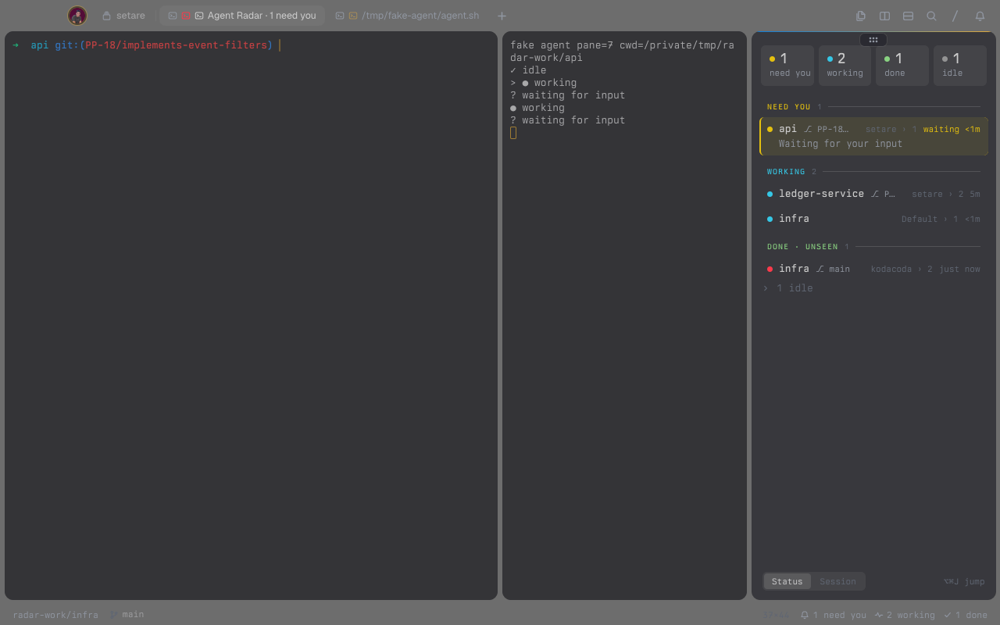

# tern-agent-radar

A [Tern](https://stencil.so/tern) plugin that shows every coding agent running in Tern, across sessions, in one pane: who is waiting for you, who is working, who just finished. Click an agent to jump to its pane.



## Install

```sh
tern plugin install github.com/edcnogueira/tern-agent-radar
```

It has only a window half, so install it on the machine whose Tern windows you use.

## Use

| Action | What it does |
| --- | --- |
| **Agent Radar** (palette, `⌥⌘R`) | Opens the radar beside the focused pane. When it is already open in another tab or session, it moves here; when it is here, it takes the focus |
| Click an agent | Switches to its session, takes it out of the deck if it was parked, focuses it. The radar moves along into that tab, so it stays in view |
| Click a count at the top | Shows only that group; click it again to show all |
| **Status** / **Session** at the bottom | Groups by state (default) or by session |
| **Jump to agent** (palette, `⌥⌘J`) | A picker of every agent, grouped like the radar, for the keyboard. A waiting agent shows its question first; agents in the same folder get their branch or `session › tab` in the name, so typing tells them apart. It doesn't move the radar |
| Status line | `N need you`, `N working`, `N done` while any agent runs; a click runs **Agent Radar** |
| Toast | `<project> needs you` when an agent starts waiting for input, unless its pane is focused. **Agent Radar: turn waiting toasts on or off** in the palette switches it |

## What the radar shows

Agents are grouped and ordered by who needs you:

| Group | Agents | Order |
| --- | --- | --- |
| Needs you | Waiting for input, as a card with the agent's question | Longest wait first |
| Working | Running a turn | Longest first |
| Done | Turn ended (done, or failed in red) and you haven't focused the pane since | Newest first |
| Idle (folded) | Idle agents you've seen, and exited ones | Newest first |

Each row has the project (the agent's folder name), its git branch, how long it has been in that state, the first line of the agent's last message (omp agents; others have none) and where it is (`session › tab`, or `parked`). A mark before the name tells the state: a ring while working, a check or a cross when a turn ended, a hollow dot when idle. The pane you're in is highlighted.

## Limits

- **States come from Tern.** Working and waiting come from the progress the agent reports (OSC 9;4); an agent that reports none always looks idle. A failed turn shows as failed only when the agent reports it.
- **Remote hosts.** Agents on remote hosts attached to the window are listed and you can jump to them, but they show no branch (git runs on this machine), and the radar can't move into a remote host's tab, so it stays where it was.
- **A background window updates late.** The radar refreshes every 1.5 s on the window's timer; a window macOS has put to sleep catches up when you bring it back.
- **Tern's own banner stays.** Tern already shows a banner when an agent waits; the toast adds the project and session. Turn the toast off if the banner is enough.

## What it runs, reads and writes

- **Runs** nothing. Branches come from Tern's git engine (`cx.git`).
- **Reads and writes** only its own `kv.json` in the plugin data folder: what it remembers per agent (state, since when, whether you've seen the end of its turn) and the grouping, filter and toast settings.
- **Network:** none.

## Development

```sh
git clone https://github.com/edcnogueira/tern-agent-radar
cd tern-agent-radar
tern plugin link .          # load it from this checkout; saving reloads it
tern plugin types .         # tern.d.luau for luau-lsp (git-ignored)
luau tests/radar.test.luau  # tests for the model: states, ordering, rows
```

`radar.luau` holds the model and doesn't use `tern`, so its tests run under the plain [`luau`](https://luau.org) CLI. `view.luau` turns the model into canvas nodes styled by `radar.css`; `window.luau` wires it to Tern. [DESIGN.md](DESIGN.md) has the design and the API behaviors it relies on; the mockups are in [`design/`](design).

## License

[MIT](LICENSE)
