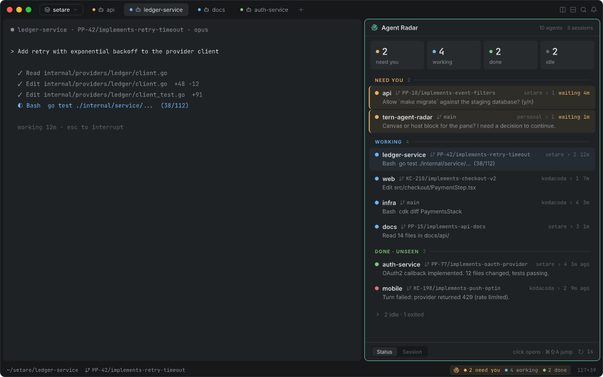

# tern-agent-radar

A [Tern](https://stencil.so/tern) plugin that shows every coding agent running in Tern, across sessions, in one pane: who is waiting for you, who is working, who just finished. Click an agent to jump to its pane.

**Status:** design. Nothing to install yet. The behavior, data sources and open API questions are in [DESIGN.md](DESIGN.md); the mockups are in [`design/agent-radar.pen`](design/agent-radar.pen) with PNG previews in [`design/screens/`](design/screens).

## License

[MIT](LICENSE)
